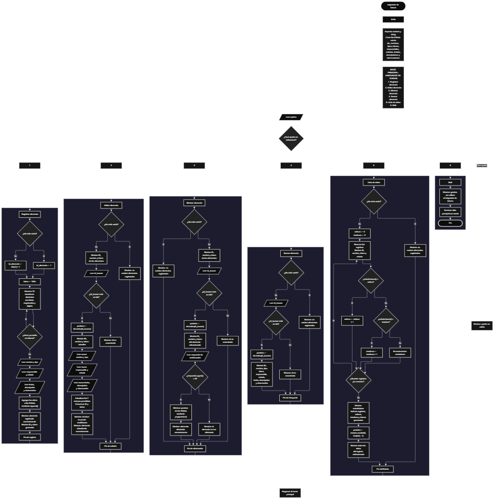

Este proyecto, llamado <b>asignador de tokens</b>, fue desarrollado en <b>python</b> como un ejercicio práctico para fortalecer la lógica de programación mediante la creación de un sistema de gestión de elementos desde la consola. El programa cuenta con un menú principal de seis opciones que permite <b>registrar, editar, eliminar, buscar y listar elementos, además de salir del sistema</b>. Cada elemento almacena información como el nombre, el tipo, el token, el responsable, el estado, la fecha de registro, la descripción y las observaciones. Los datos se organizan mediante nueve listas paralelas que relacionan cada elemento con su identificador. Una de las características principales del proyecto es la generación automática de tokens únicos con el prefijo <b>TKN-</b>, seguido de diez caracteres aleatorios compuestos por letras mayúsculas y dígitos. Durante su desarrollo se aplicaron conceptos fundamentales de programación, como variables, listas, estructuras condicionales, ciclos repetitivos, métodos de listas y módulos de Python. Además, el sistema calcula estadísticas de los estados de los elementos y selecciona aleatoriamente un registro para mostrar su información completa. Este proyecto permite poner en práctica los conocimientos adquiridos en Python y sirve como base para desarrollar sistemas de gestión más avanzados.

<h2 align="center">⚙️ Funcionamiento del menú principal</h2>

### ➕ Registrar elemento

La opción <b>1) registrar elemento</b> permite incorporar un nuevo elemento al sistema. Primero, el programa comprueba si la lista <b>ids</b> está vacía mediante la condición <b>len(ids) == 0</b>. Si no existen registros, asigna el identificador <b>1</b> a la variable <b>id_elemento</b>. En caso contrario, genera el siguiente identificador mediante la expresión <b>ids[-1] + 1</b>. Después, inicia un ciclo <b>while True</b> para generar un token que comienza con el prefijo <b>"TKN-"</b>. Mediante un ciclo <b>for</b> que se repite diez veces, agrega caracteres seleccionados aleatoriamente de <b>string.ascii_uppercase</b> y <b>string.digits</b>. El token generado se comprueba mediante la condición <b>token not in tokens</b>. Si ya existe, el programa genera otro; si no existe, finaliza el ciclo y acepta el token. A continuación, solicita el <b>nombre, tipo, responsable, estado, fecha de registro, descripción y observación</b>. Los datos se almacenan en las nueve listas mediante el método <b>append()</b>, manteniendo la correspondencia entre los valores de cada registro. Finalmente, muestra el mensaje <b>"elemento registrado correctamente."</b>, el ID asignado y el token generado.

### ✏️ Editar elemento

La opción <b>2) editar elemento</b> permite modificar la información de un elemento registrado. Primero, el programa comprueba si existen registros en la lista <b>ids</b>. Si está vacía, muestra el mensaje <b>"no existen elementos registrados."</b>. En caso contrario, presenta una lista con el ID, el nombre y el token de cada elemento mediante un ciclo <b>for</b>. Después, solicita el identificador que se desea editar y comprueba si se encuentra en la lista <b>ids</b>. Si existe, obtiene la posición correspondiente mediante <b>ids.index(id_buscar)</b> y muestra los datos actuales del elemento: ID, nombre y token. A continuación, solicita el nuevo nombre, tipo, responsable, estado, fecha, descripción y observación, actualizando directamente los valores de las listas correspondientes. El identificador y el token se conservan sin cambios. El programa informa esta restricción mediante el mensaje <b>"el token no puede modificarse."</b> y finaliza mostrando <b>"elemento actualizado correctamente."</b>. Si el ID introducido no existe, presenta el mensaje <b>"id no encontrada."</b>.

### 🗑️ Eliminar elemento

La opción <b>3) eliminar elemento</b> permite eliminar un registro mediante su identificador. Primero, el programa comprueba si existen elementos registrados. Si la lista <b>ids</b> está vacía, muestra el mensaje <b>"no existen elementos registrados."</b>. Si hay registros, presenta una lista con el ID, el nombre y el token de cada elemento. Después, solicita el ID que se desea eliminar y comprueba si está presente en la lista. Si lo encuentra, obtiene su posición mediante <b>ids.index(id_buscar)</b> y muestra el ID, el nombre y el token del elemento seleccionado. A continuación, solicita confirmación mediante la pregunta <b>"¿desea eliminar este elemento? (s/n): "</b>. Si la respuesta convertida a mayúsculas mediante <b>upper()</b> es igual a <b>"S"</b>, utiliza el método <b>pop(posicion)</b> para eliminar la misma posición de las nueve listas: <b>ids, nombres, tipos, tokens, responsables, estados, fechas, descripciones y observaciones</b>. De esta manera, los datos de las listas permanecen sincronizados. Finalmente, muestra el mensaje <b>"elemento eliminado correctamente."</b>. Si no se confirma la operación, presenta <b>"el elemento no fue eliminado."</b>. Si el ID no existe, muestra <b>"id no encontrada."</b>.

### 🔎 Buscar elemento

La opción <b>4) buscar elemento</b> permite localizar un registro mediante su identificador. Primero, el programa comprueba si existen elementos registrados. Si la lista <b>ids</b> está vacía, muestra el mensaje <b>"no existen elementos registrados."</b>. En caso contrario, solicita el ID que se desea buscar y verifica si se encuentra en la lista. Si existe, utiliza <b>ids.index(id_buscar)</b> para obtener la posición del elemento y muestra toda su información: <b>ID, nombre, tipo, token, responsable, estado, fecha, descripción y observación</b>. Si el identificador no se encuentra, presenta el mensaje <b>"id no encontrada."</b>. Esta operación facilita consultar la información completa de un elemento sin necesidad de recorrer manualmente todos los registros.

### 📋 Lista de datos

La opción <b>5) lista de datos</b> permite visualizar los elementos registrados y consultar las estadísticas generales del sistema. Primero, el programa comprueba si la lista <b>ids</b> está vacía. Si no existen registros, muestra el mensaje <b>"no existen elementos registrados."</b>. Si hay elementos disponibles, inicializa en cero los contadores <b>activos</b> e <b>inactivos</b>. Después, utiliza un ciclo <b>for</b> para recorrer las listas y mostrar el ID, el nombre, el token y el estado de cada elemento. Durante el recorrido, compara los estados mediante el método <b>lower()</b>, que permite reconocer los valores esperados independientemente del uso de mayúsculas y minúsculas. Cuando el estado coincide con <b>"activo"</b>, incrementa el contador <b>activos</b>; cuando coincide con <b>"inactivo"</b>, incrementa <b>inactivos</b>. Al finalizar, muestra la cantidad total de registros mediante <b>len(ids)</b>, el número de elementos activos e inactivos y la cantidad de tokens generados mediante <b>len(tokens)</b>. Posteriormente, selecciona una posición aleatoria utilizando <b>random.randint(0, len(ids) - 1)</b> y muestra toda la información del elemento elegido bajo el título <b>"registro seleccionado"</b>. Esta operación permite consultar las estadísticas y revisar un registro seleccionado al azar.

### 🚪 Salir del menú principal

La opción <b>6) salir</b> permite finalizar la ejecución del programa. Cuando el usuario selecciona esta opción, el sistema muestra el mensaje <b>"gracias por utilizar el asignador de tokens."</b> y ejecuta la instrucción <b>break</b>, que termina el ciclo principal <b>while True</b>. De esta manera, el menú deja de mostrarse y el programa finaliza. Si el usuario introduce una opción que no coincide con los valores del <b>1</b> al <b>6</b>, el bloque <b>else</b> muestra el mensaje <b>"opción no válida."</b> y el ciclo continúa, permitiendo seleccionar otra operación.

<h2 align="center">🧠 Temas aplicados en el proyecto</h2>

### 📦 Variables

En este proyecto se utilizan variables para almacenar la opción seleccionada en el menú, los datos introducidos durante el registro y la edición, el identificador del elemento que se desea localizar, la posición del registro encontrado, el token que se está generando, la respuesta de confirmación y los contadores empleados para calcular las estadísticas. Cada variable cumple una función específica dentro de las operaciones de gestión de elementos.

🔢 **Opcion:** Almacena la opción seleccionada por el usuario en el menú principal.

🆔 **Id_elemento:** Almacena el identificador asignado al nuevo elemento.

🔎 **Id_buscar:** Guarda el identificador introducido para localizar un elemento.

📍 **Posicion:** Representa el índice del elemento encontrado o seleccionado aleatoriamente.

🔐 **Token:** Almacena temporalmente el token generado mediante el prefijo y los caracteres aleatorios.

🔄 **I:** Funciona como contador en los ciclos `for` utilizados para generar caracteres y recorrer registros.

📊 **Activos:** Cuenta los elementos cuyo estado coincide con `activo`.

📊 **Inactivos:** Cuenta los elementos cuyo estado coincide con `inactivo`.

✅ **Respuesta:** Almacena la confirmación introducida antes de eliminar un elemento.

### 🗃️ Listas

En este proyecto se utilizan nueve listas paralelas para almacenar la información de cada elemento. Cada lista contiene un tipo de dato y todas se relacionan mediante el mismo índice. Por ejemplo, los datos de un elemento situado en la posición <b>0</b> se encuentran distribuidos entre <b>ids[0], nombres[0], tipos[0], tokens[0], responsables[0], estados[0], fechas[0], descripciones[0] y observaciones[0]</b>. Esta organización permite registrar, buscar, modificar, mostrar y eliminar elementos manteniendo la correspondencia entre sus datos. Las listas se crean vacías al iniciar el programa y no tienen una capacidad máxima definida explícitamente.

🆔 **Ids:** Almacena los identificadores numéricos de los elementos.

📝 **Nombres:** Almacena los nombres de los elementos registrados.

🗂️ **Tipos:** Guarda el tipo de cada elemento.

🔐 **Tokens:** Almacena los tokens únicos generados para los registros.

👤 **Responsables:** Guarda las personas responsables de los elementos.

📌 **Estados:** Almacena el estado de cada elemento, como activo o inactivo.

📅 **Fechas:** Guarda las fechas de registro.

📄 **Descripciones:** Almacena las descripciones de los elementos.

💬 **Observaciones:** Guarda las observaciones adicionales.

### 🔀 Estructuras condicionales

En este proyecto se utilizan las estructuras <b>if, elif y else</b> para controlar las opciones del menú y determinar qué operación debe ejecutarse. También permiten comprobar si existen registros antes de realizar una operación, verificar si un identificador está presente en la lista, determinar si un token generado ya existe, confirmar la eliminación de un elemento y clasificar los registros según su estado. Estas condiciones permiten que el programa responda de manera diferente según los datos almacenados y las decisiones del usuario.

### 🔄 Estructuras repetitivas

En este proyecto se utilizan los ciclos <b>while</b> y <b>for</b>. El ciclo <b>while True</b> mantiene activo el menú principal hasta que se selecciona la opción de salida. También se emplea otro ciclo <b>while True</b> durante la generación de tokens, que permite repetir el proceso cuando se obtiene un token que ya existe en la lista. El ciclo <b>for</b> genera los diez caracteres del token y recorre los registros para mostrar los elementos y calcular las estadísticas. La instrucción <b>break</b> se utiliza para finalizar los ciclos cuando se cumple la condición correspondiente.

### 🎯 Estructura de selección

El programa utiliza una cadena de condiciones <b>if, elif y else</b> para evaluar el valor almacenado en la variable <b>opcion</b> y ejecutar el bloque correspondiente. Cada alternativa representa una operación específica: <b>registrar, editar, eliminar, buscar, listar datos o salir</b>. El bloque <b>else</b> funciona como alternativa cuando el valor introducido no coincide con ninguna de las opciones disponibles y muestra el mensaje <b>"opción no válida."</b>. Esta estructura organiza el funcionamiento del menú y permite acceder a las distintas operaciones del sistema.

### 🔐 Generación aleatoria de tokens

El programa utiliza los módulos <b>random</b> y <b>string</b> para generar automáticamente tokens. La variable <b>token</b> comienza con el prefijo <b>"TKN-"</b>. Después, el ciclo <b>for</b> agrega diez caracteres seleccionados mediante <b>random.choice(string.ascii_uppercase + string.digits)</b>. La propiedad <b>string.ascii_uppercase</b> proporciona las letras mayúsculas del alfabeto inglés y <b>string.digits</b> proporciona los dígitos del cero al nueve. Una vez generado el token, la condición <b>token not in tokens</b> comprueba que no coincida con uno de los tokens almacenados actualmente. Si ya existe, se repite la generación; si es diferente, el ciclo finaliza y el token puede registrarse. Este procedimiento busca evitar duplicados entre los registros existentes, aunque no utiliza un generador criptográficamente seguro ni garantiza la unicidad frente a sistemas externos.

### 🔍 Búsqueda e identificación de registros

El programa utiliza el operador <b>in</b> para comprobar si un identificador se encuentra en la lista <b>ids</b> y el método <b>index()</b> para obtener la posición del elemento correspondiente. La condición <b>id_buscar in ids</b> determina si existe el registro solicitado, mientras que <b>ids.index(id_buscar)</b> devuelve su índice. Esta posición se utiliza para acceder a la información relacionada en las demás listas. El mismo procedimiento se aplica en las operaciones de edición, eliminación y búsqueda, lo que permite identificar los registros de manera uniforme.

### 📊 Estadísticas de los estados

Durante la opción <b>5) lista de datos</b>, el programa inicializa los contadores <b>activos</b> e <b>inactivos</b> y recorre todos los registros. En cada repetición, utiliza <b>estados[i].lower()</b> para comparar el estado almacenado con las palabras <b>"activo"</b> e <b>"inactivo"</b>. Cuando encuentra una coincidencia, incrementa el contador correspondiente. Al finalizar, muestra la cantidad de registros mediante <b>len(ids)</b>, los totales de cada estado y la cantidad de tokens mediante <b>len(tokens)</b>. Los estados diferentes de los dos valores reconocidos no se contabilizan en ninguna de estas categorías.

<h2 align="center">¿Cómo se implementaron las operaciones crud en el proyecto?</h2>

Las operaciones <b>crud</b> se implementaron mediante las opciones del menú principal para administrar los elementos registrados. La operación <b>crear</b> corresponde a <b>registrar elemento</b>, donde se generan un identificador y un token, se solicitan los datos y se incorporan a las listas mediante <b>append()</b>. La operación <b>leer</b> se realiza mediante <b>buscar elemento</b> y <b>lista de datos</b>, que permiten consultar la información individual, visualizar los registros y revisar sus estadísticas. La operación <b>actualizar</b> corresponde a <b>editar elemento</b>, donde se modifican los datos permitidos de un registro existente, conservando su identificador y token. Finalmente, la operación <b>eliminar</b> se realiza mediante <b>eliminar elemento</b>, que solicita confirmación y utiliza <b>pop()</b> para retirar la posición correspondiente de las nueve listas. Estas operaciones utilizan variables, listas, condiciones y ciclos para gestionar la información almacenada temporalmente durante la ejecución del programa.

<h2 align="center">Diagrama de flujo del proyecto</h2>

<h2 align="center">🛡️ Validaciones del programa</h2>

### 📭 No existen elementos registrados

Esta comprobación se utiliza en las opciones de <b>editar, eliminar, buscar y lista de datos</b>. El programa evalúa la condición <b>len(ids) == 0</b> para determinar si la lista de identificadores está vacía. Si no existen elementos, muestra el mensaje <b>"no existen elementos registrados."</b> y evita continuar con la operación que necesita información almacenada. Esta comprobación permite gestionar los casos en los que se intenta consultar o administrar una lista vacía.

### 🔐 Token duplicado

Esta comprobación se realiza durante el registro de un nuevo elemento. Después de construir el token con el prefijo <b>"TKN-"</b> y diez caracteres aleatorios, el programa utiliza la condición <b>token not in tokens</b> para comprobar que el valor generado no esté presente en la lista de tokens. Si el token ya existe, el ciclo <b>while True</b> repite el procedimiento y genera otro. Cuando encuentra un token que no está almacenado, sale del ciclo y continúa con el registro. Esta comprobación evita aceptar un token duplicado entre los elementos que permanecen registrados en la lista.

### ❌ Identificador no encontrado

Esta comprobación se utiliza en las opciones de <b>editar, eliminar y buscar elemento</b>. Después de solicitar el identificador, el programa verifica si está presente en la lista <b>ids</b>. Si existe, obtiene su posición mediante <b>index()</b> y continúa con la operación correspondiente. Si no se encuentra, muestra el mensaje <b>"id no encontrada."</b>. Esta comprobación evita que el programa intente modificar, eliminar o consultar un registro utilizando un identificador inexistente.

### 🗑️ Confirmación de eliminación

Antes de eliminar un elemento, el programa solicita confirmación mediante la pregunta <b>"¿desea eliminar este elemento? (s/n): "</b>. La respuesta se convierte a mayúsculas mediante <b>upper()</b> y se compara con el valor <b>"S"</b>. Si coincide, el sistema elimina la posición correspondiente de las nueve listas. Si la respuesta es diferente, muestra el mensaje <b>"el elemento no fue eliminado."</b>. Esta comprobación permite confirmar la operación antes de retirar el registro. Cualquier respuesta distinta de <b>"S"</b>, incluida una respuesta no prevista, cancela la eliminación.

### 🔒 Token no modificable

Durante la opción <b>2) editar elemento</b>, el programa permite modificar el nombre, tipo, responsable, estado, fecha, descripción y observación. No solicita un nuevo token ni modifica la lista <b>tokens</b>. Además, muestra el mensaje <b>"el token no puede modificarse."</b> para informar al usuario de esta restricción. De esta manera, el token original permanece asociado al elemento durante la edición, mientras que los demás campos autorizados se actualizan.

### 📌 Clasificación de estados

Durante la opción <b>5) lista de datos</b>, el programa utiliza el método <b>lower()</b> para comparar los estados con los valores <b>"activo"</b> e <b>"inactivo"</b>, independientemente de las mayúsculas y minúsculas. Los estados reconocidos incrementan los contadores correspondientes. Sin embargo, el código no valida los valores introducidos durante el registro o la edición. Si se introduce un estado diferente de los previstos, el dato se almacena, pero no se contabiliza como activo ni como inactivo.

### 🎲 Selección aleatoria de un registro

Después de mostrar las estadísticas, el programa selecciona un registro mediante <b>random.randint(0, len(ids) - 1)</b>. Esta operación se ejecuta únicamente cuando existen registros, ya que previamente se comprueba que la lista <b>ids</b> no esté vacía. El número generado corresponde a una posición válida dentro de las listas y permite mostrar todos los datos del elemento seleccionado. La selección es aleatoria y no modifica el registro ni sus valores.

### ⚠️ Opción no válida

El menú principal evalúa las opciones del <b>1</b> al <b>6</b>. Si el usuario introduce un valor diferente, el bloque <b>else</b> muestra el mensaje <b>"opción no válida."</b>. Después, el ciclo <b>while True</b> continúa y vuelve a presentar el menú principal. Esta alternativa informa al usuario cuando la opción introducida no corresponde a ninguna de las operaciones disponibles.

### 🔢 Entrada numérica del identificador

En las operaciones de edición, eliminación y búsqueda, el programa utiliza <b>int(input("ingrese la id del elemento: "))</b> para convertir el identificador introducido en un número entero. Esta conversión permite compararlo con los valores almacenados en la lista <b>ids</b>. Sin embargo, no existe un manejo de excepciones para controlar entradas no numéricas. Si el usuario introduce letras u otro contenido que no pueda convertirse a entero, se producirá un error que puede interrumpir la ejecución del programa. Por tanto, el código realiza la conversión numérica, pero no incluye una validación para recuperarse de entradas incorrectas.

<h2 align="center">🎯 Objetivo del proyecto</h2>

El objetivo principal de este proyecto es fortalecer la <b>lógica de programación</b> mediante el desarrollo de un sistema de gestión de elementos y generación de tokens en <b>python</b>. A través de su construcción se busca aplicar los conocimientos adquiridos sobre variables, listas, estructuras condicionales, ciclos repetitivos, métodos de listas y módulos de Python. Además, el proyecto permite comprender cómo registrar, consultar, modificar y eliminar información, generar identificadores, crear tokens únicos mediante caracteres aleatorios, calcular estadísticas y seleccionar registros al azar. De esta manera, se establece una base para desarrollar sistemas de gestión más completos que permitan organizar elementos y asignar identificadores de forma estructurada.

